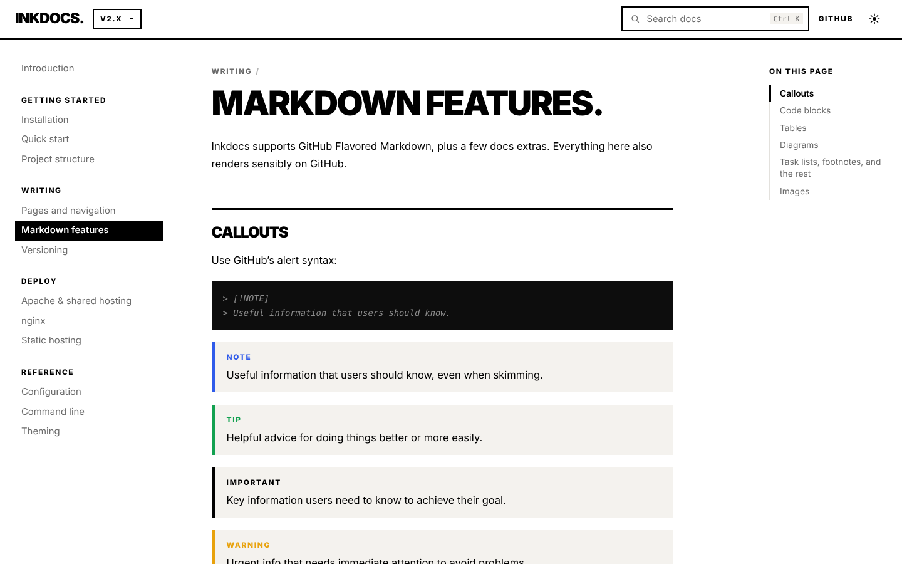
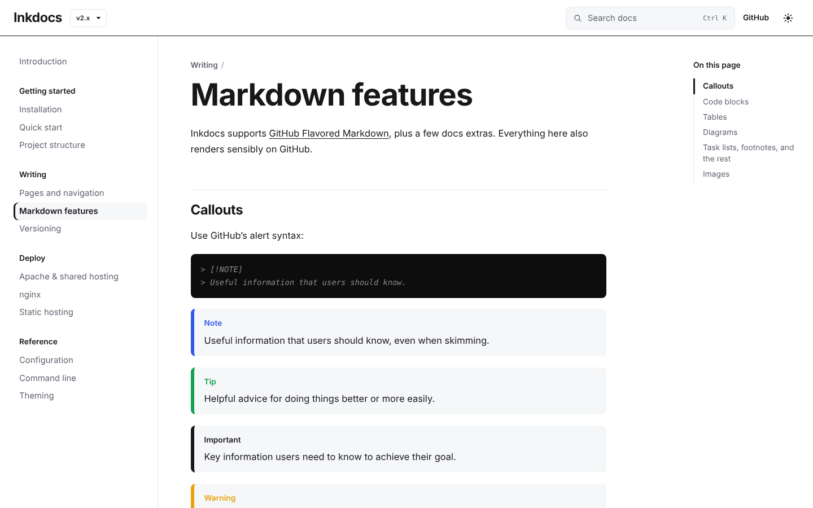
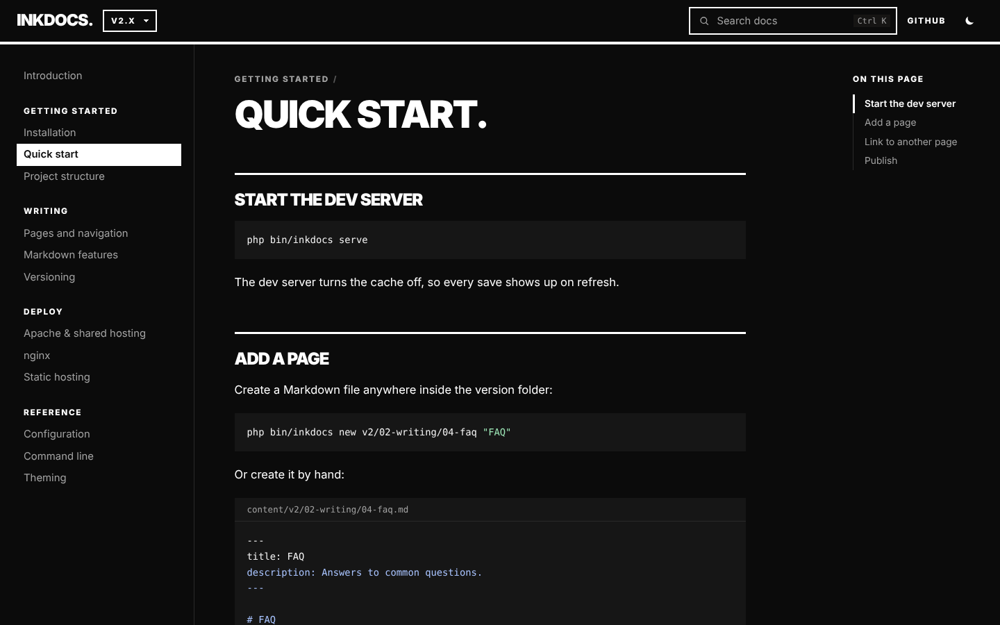

# Inkdocs

**A fast, flat-file documentation engine for PHP 8.** Write Markdown in folders, get a docs site with search, versions and a sidebar. No database, no Node build step, no admin panel.

PHP renders each page once and writes plain HTML to `public/cache`. After that Apache or nginx serves the file directly, so PHP never starts. A cheap shared host answers like a CDN.



## Features

- **Folders become the sidebar.** Number prefixes set the order and disappear from URLs (`02-guide/01-install.md` → `/guide/install`).
- **Versioned docs.** `content/v2`, `content/v1`, a version switcher that keeps you on the same page, and a banner on old versions.
- **Instant search.** A prebuilt index searched in the browser. Results jump to the matching section. `Ctrl K` or `/` to open.
- **Docs that also work on GitHub.** Link to `../install.md`; Inkdocs rewrites it to the page URL. Callouts use GitHub's `> [!NOTE]` syntax.
- **Zero JS for code.** Syntax highlighting happens on the server (180+ languages), with file titles and copy buttons.
- **Broken-link checker.** `bin/inkdocs check` fails CI when a page links to a missing file.
- **AI-ready.** `/llms.txt`, `/llms-full.txt`, and the raw Markdown of any page at `page.md`.
- **Deploy anywhere.** Apache and LiteSpeed (`.htaccess` included), nginx (config included), or `bin/inkdocs build` for GitHub Pages, Netlify and S3.
- **Two themes, no outside requests.** Bold (black and white, based on wayan.cc) or Neutral, each with light and dark mode. Inter and Mermaid are bundled, so pages never call Google Fonts or a CDN.
- **Small and hackable.** Under 2,000 lines of PHP including templates. One CSS and one JS file, plus a design-tokens file you can override.





## Quick start

```bash
composer create-project wayancc/inkdocs my-docs
cd my-docs
php bin/inkdocs serve        # http://127.0.0.1:8000
```

Add a page:

```bash
php bin/inkdocs new v2/02-writing/04-faq "FAQ"
```

The starter content is the Inkdocs documentation itself. Replace `content/` with yours.

## How it works

```
Request ─┬─▶ public/cache/<path>/index.html exists? ──▶ web server sends it (no PHP)
         │
         └─▶ index.php ─┬─▶ cached file exists? ──▶ readfile() before autoload (~0.6 ms)
                        └─▶ render Markdown → write cache → respond (~15–25 ms, once)
```

Measured on the bundled docs with PHP 8.3 and OPcache, PHP built-in server:

| Request | Time |
| --- | --- |
| First render of a page (Markdown, highlighting, layout) | 16–23 ms |
| Cached page via the PHP fast path | 0.5–0.8 ms |
| Cached page via Apache/nginx | static file speed |
| Full static build, 15 pages, 2 versions | 0.09 s |

## Project layout

```
bin/inkdocs        CLI: serve, build, cache:warm, cache:clear, check, new
config.php         Site settings (all optional)
content/           Markdown, one folder per version
public/            Web root: index.php, .htaccess, assets/, cache/
src/               The engine
theme/             layout.php and nav.php
deploy/nginx.conf  nginx server block
tests/run.php      Test suite (no dependencies)
```

## Design

Set `'theme' => 'wayan'` (Bold, the default) or `'neutral'` in `config.php`. Readers switch between light and dark with the sun/moon button.

- Every color, font and border width lives in `public/assets/wyn-tokens.css`.
- Every theme class and data attribute starts with `wyn-`, so your own CSS never collides with it.
- See `content/v2/04-reference/03-theming.md` for brand overrides.

## Configuration

```php
return [
    'site_name' => 'Acme Docs',
    'site_url'  => 'https://docs.acme.dev',
    'base_url'  => '/',                       // '/docs/' for a subfolder install
    'versions'  => ['v2' => 'v2.x', 'v1' => 'v1.x'],
    'edit_url'  => 'https://github.com/acme/docs/edit/main/content/{path}',
    'nav_links' => ['GitHub' => 'https://github.com/acme/docs'],
    'cache'     => true,
];
```

Every option is documented in `content/v2/04-reference/01-configuration.md`.

## Deploying

| Host | What to do |
| --- | --- |
| Shared hosting (cPanel, Plesk) | Upload, point the document root at `public/`. The `.htaccess` serves cached pages. |
| nginx + PHP-FPM | Use `deploy/nginx.conf`. Run `php bin/inkdocs cache:warm` after each deploy. |
| GitHub Pages | Enable Pages → GitHub Actions. `.github/workflows/pages.yml` builds and publishes on push. |
| Netlify, Cloudflare Pages, S3 | `php bin/inkdocs build --out=dist` and upload `dist/`. |

## Development

```bash
composer install
composer test               # 39 checks: routing, caching, Markdown, design, build
php bin/inkdocs check       # broken links
```

## Roadmap

- [ ] Tabs and code groups (`::: tabs`)
- [ ] i18n folders (`content/en`, `content/id`)
- [ ] Webhook endpoint to rebuild the cache on `git push`
- [ ] Theme packages via Composer

## License

MIT
