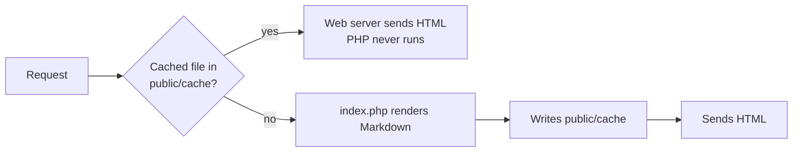

# Project structure

```text
my-docs/
├── bin/inkdocs         CLI: serve, build, cache:warm, check, new
├── config.php          Site settings
├── content/            Your Markdown (one folder per version)
│   ├── v2/
│   └── v1/
├── public/             The only folder exposed to the web
│   ├── index.php       Front controller
│   ├── .htaccess       Apache rules that serve cached pages
│   ├── assets/         CSS, JS, favicon, your images
│   └── cache/          Rendered pages (generated, safe to delete)
├── src/                The engine
├── theme/              Plain PHP templates
└── vendor/             Composer dependencies
```

## How a request is served



The first visit to a page after a change costs a few milliseconds of PHP. Every visit after that is a static file.

## What gets ignored

Files and folders that start with `_` or `.` are skipped. Use them for drafts, partials or notes:

```text
content/v2/_notes/roadmap.md     not published
content/v2/.drafts/idea.md       not published
```

You can also hide a single page with front matter. See [pages and navigation](../02-writing/01-pages-and-navigation.md#front-matter).
