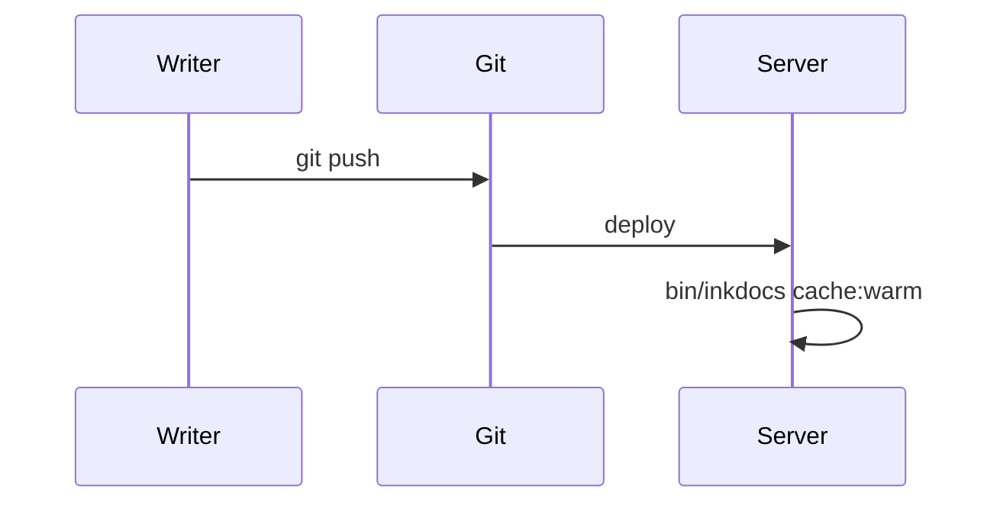

# Markdown features

Inkdocs supports [GitHub Flavored Markdown](https://github.github.com/gfm/), plus a few docs extras. Everything here also renders sensibly on GitHub.

## Callouts

Use GitHub’s alert syntax:

```markdown
> [!NOTE]
> Useful information that users should know.
```

> [!NOTE]
> Useful information that users should know, even when skimming.

> [!TIP]
> Helpful advice for doing things better or more easily.

> [!IMPORTANT]
> Key information users need to know to achieve their goal.

> [!WARNING]
> Urgent info that needs immediate attention to avoid problems.

> [!CAUTION]
> Advises about risks or negative outcomes of certain actions.

## Code blocks

Code is highlighted on the server, so pages ship no highlighting JavaScript. More than 180 languages are supported. Add `title="…"` to show a file name:

````markdown
```php title="config.php"
return ['site_name' => 'Acme Docs'];
```
````

```php title="config.php"
<?php

return [
    'site_name' => 'Acme Docs',
    'versions'  => ['v3' => '3.x', 'v2' => '2.x'],
    'cache'     => true,
];
```

```js
// Every code block gets a copy button.
const res = await fetch('/search.json');
console.log(`${(await res.json()).length} sections indexed`);
```

## Tables

| Feature | Inkdocs | Typical PHP CMS |
| --- | :---: | :---: |
| Database | None | MySQL |
| PHP on a cached request | No | Yes |
| Admin panel to secure | None | Yes |

## Diagrams

Fenced blocks marked `mermaid` render as diagrams. Mermaid is bundled and loads only on pages that use it, so other pages stay light and nothing is fetched from a CDN.



## Task lists, footnotes, and the rest

- [x] Strikethrough: ~~old way~~
- [x] Autolinks: https://example.com
- [x] Footnotes[^1]
- [ ] Your next page

[^1]: Footnotes collect at the bottom of the page.

## Images

Put images in `public/assets/` and link with a root-relative path. Inkdocs adds the base URL for you, so this works in a subfolder install too:

```markdown

```
